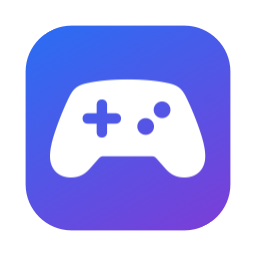
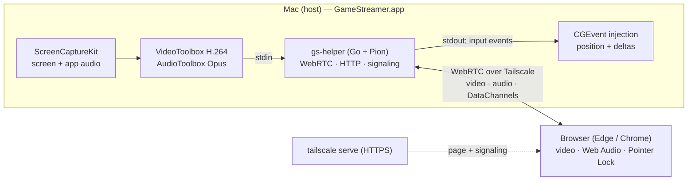

<p align="center">
  
</p>

<h1 align="center">GameStreamer</h1>

<p align="center">
  Stream games from your Mac to a friend's browser over Tailscale — with a mouse that actually works.<br>
  <a href="README.ru.md">Русская версия</a>
</p>

<p align="center">
  <a href="https://github.com/defcatcher/gamestreamer/releases/latest"></a>
  
  
  <a href="LICENSE"></a>
</p>

---

A tiny menu-bar app for Apple Silicon Macs. It captures the screen and game audio, encodes with the hardware H.264 encoder and sends everything over WebRTC to a web page. The person on the other end opens a link in Edge or Chrome on Windows (or anywhere) and plays with keyboard and mouse. **Nothing to install on the viewer's side.**

## Why

We tried Parsec, Sunshine + Moonlight and Steam Remote Play with a Mac mini as the host. In all three the keyboard worked, but **the mouse didn't move at all**, not even on the desktop, with every permission granted. Posting a `CGEvent` that carries *both* the new cursor position *and* the raw deltas (`kCGMouseEventDeltaX/Y`) at the HID tap does work, for the desktop as well as for games running under CrossOver. GameStreamer is built around that.

## Features

- **Screen capture** with ScreenCaptureKit at 60 or 120 fps, **hardware H.264** (VideoToolbox, low-latency rate control, no B-frames).
- **WebRTC** via [Pion](https://github.com/pion/webrtc): paced sending, NACK retransmissions, keyframes on demand.
- **Low-latency playback**: frames carry `playout-delay = 0`, so the browser shows each frame as soon as it's decoded.
- **Keyboard and mouse** over DataChannels: unreliable/unordered for motion, reliable for clicks and keys. Physical key mapping (`KeyboardEvent.code` → macOS keycodes), Ctrl → Control, Alt → Option.
- **Two mouse modes**: *menu* (absolute position, the viewer's own zero-lag cursor) and *camera* (Pointer Lock + raw deltas, unlimited turning in FPS/third-person games). Switch with **Ctrl+Alt+M**. There is also an *experimental* auto-switch for games that pin the cursor; it doesn't trigger for games under CrossOver and is untested with most native games.
- **Game audio only**: a separate audio capture that skips Discord, messengers and notifications, encoded to Opus (10 ms frames) and played with WebCodecs + Web Audio.
- **Built-in latency meter**: the stats overlay shows glass-to-glass latency split into host / network / browser.
- **Menu-bar app**: PIN, bitrate, frame rate, audio source, permission status, launch at login.
- **Remote diagnostics**: the viewer's browser reports its stats to the host log, so you can debug without asking them for screenshots.
- UI in **English and Russian**, picked automatically.

## Latency

Measured with the built-in meter, from the moment a frame is captured on the Mac to when the browser puts it on screen (Mac mini M4, 1080p60, same machine, no network):

| | before tuning | now |
|---|---|---|
| capture → sent (incl. ~6 ms hardware encode) | 7 ms | 7 ms |
| browser: received → on screen | 36 ms | 20 ms |
| **total** | **43 ms** | **27–28 ms** (p95 33–39) |

Over the Internet add your one-way network delay (Tailscale direct connection: usually 5–20 ms). Most of what's left in the browser is waiting for the viewer's display refresh at 60 Hz.

## How it works



Two processes inside one `.app`: the Swift part owns everything macOS-specific (capture, encoding, input, menu bar, permissions), the Go part owns the network side. They talk over the helper's stdin/stdout with tiny framed messages. Only the Swift app needs macOS permissions.

## Requirements

- **Host:** Apple Silicon Mac, macOS 14 or newer.
- **Viewer:** a desktop browser based on Chromium (Edge, Chrome). Safari and Firefox are untested.
- **Network:** [Tailscale](https://tailscale.com) on both machines (free tier is fine), in one tailnet or with the Mac shared to the viewer. No port forwarding.

## Install

1. Download `GameStreamer-*.zip` from [Releases](https://github.com/defcatcher/gamestreamer/releases/latest), unzip, move **GameStreamer.app** to **Applications**.
2. The app is signed with a self-signed certificate and **not notarized**, so the first launch is blocked. Open it once, then go to **System Settings → Privacy & Security** and click **Open Anyway**. Or run:
   ```bash
   xattr -dr com.apple.quarantine /Applications/GameStreamer.app
   ```
3. Grant the two permissions it asks for: **Screen & System Audio Recording** and **Accessibility** (called *Device Control* on newer macOS). The menu-bar icon shows ✓/✗ for both.
4. Turn on HTTPS for the page (needed for Keyboard Lock, so Esc / Alt+Tab reach the game):
   ```bash
   tailscale serve --bg --https=443 http://127.0.0.1:8765
   ```
   The first time, Tailscale will ask you to enable HTTPS for your tailnet in its admin console. Heads-up: certificates are public, so your machine name will appear in Certificate Transparency logs.

## Use

1. Start GameStreamer (gamepad icon in the menu bar). Optional: *Launch at login*.
2. Send the viewer `https://<your-mac>.<tailnet>.ts.net` and the 6-digit **PIN** from the menu.
3. They open it in Edge/Chrome, type the PIN and play.

| Shortcut (viewer) | Action |
|---|---|
| **Ctrl+Alt+M** | mouse: *menu* ↔ *camera* (use camera for first-person / third-person games) |
| **Ctrl+Alt+F** | fullscreen |
| **Ctrl+Alt+S** | stats overlay: latency, fps, bitrate, decoder, losses |

The Mac must stay **unlocked**: neither capture nor input work on the lock screen. While someone is connected, the app keeps the display awake.

**Audio sources** (menu → Audio): *games only* (anything running through CrossOver/Wine, Warcraft III, plus apps you tick), *everything except chats* (Discord, Telegram, Slack, notifications…), or *off*.

## Troubleshooting

| Problem | What to do |
|---|---|
| Black screen, but stats show packets arriving | Usually Chrome with hardware video decoding off. Try **Edge**, or enable *Use graphics acceleration when available* in Chrome settings. |
| No sound | Click the red *"The browser muted the sound"* button. Make sure something is playing on the Mac and the audio mode isn't *games only* with no game running. `?webrtcaudio` switches to the browser's built-in audio output. |
| Camera stops turning at the screen edge | Switch to *camera* mode: **Ctrl+Alt+M**. |
| Nothing works after the Mac slept | Unlock the Mac. |
| Something else | Menu → *Show log* (`~/Library/Logs/GameStreamer/host.log`). The viewer's stats are in there as `viewer stats`. Opening the page with `?diag` adds a decoder self-test. |

## Security

- Access is protected by a **6-digit PIN** (5 wrong tries → 60 s lockout) and by the fact that the server listens **only on localhost and the Tailscale address**.
- **Do not expose it to the Internet** directly. Whoever gets in controls your Mac's keyboard and mouse.
- One viewer at a time; a new connection replaces the old one. Regenerate the PIN from the menu any time.

## Build from source

Needs Xcode Command Line Tools and Go 1.27+ (see `helper/go.mod`).

```bash
./scripts/make-cert.sh          # once: local self-signed signing identity in .signing/
./scripts/build.sh --install    # build, copy to /Applications, restart
```

Signing with a stable identity means macOS keeps the permissions across rebuilds. `build.sh` calls `swiftc` directly (SwiftPM in some Command Line Tools versions is broken). `--run` restarts from `build/` instead; `GS_BUILD_DIR=… ./scripts/build.sh` builds a separate copy, handy for testing a second instance with `-port 8766 --test-pattern` while the main one is in use.

```
host/        Swift: menu bar, ScreenCaptureKit, VideoToolbox, Opus, CGEvent input
helper/      Go: Pion WebRTC, HTTP, signaling, pacing; web/ = the viewer page
scripts/     make-cert.sh, build.sh
```

## Limitations

- H.264 only, one display, one viewer, no gamepad yet.
- Apple Silicon only; not notarized.
- Automatic camera-mode switching is experimental: it doesn't work for games under CrossOver and has barely been tested with native Mac games. Ctrl+Alt+M always works.

## Credits

[Pion WebRTC](https://github.com/pion/webrtc) · Apple ScreenCaptureKit, VideoToolbox, AudioToolbox.

## License

[MIT](LICENSE)
